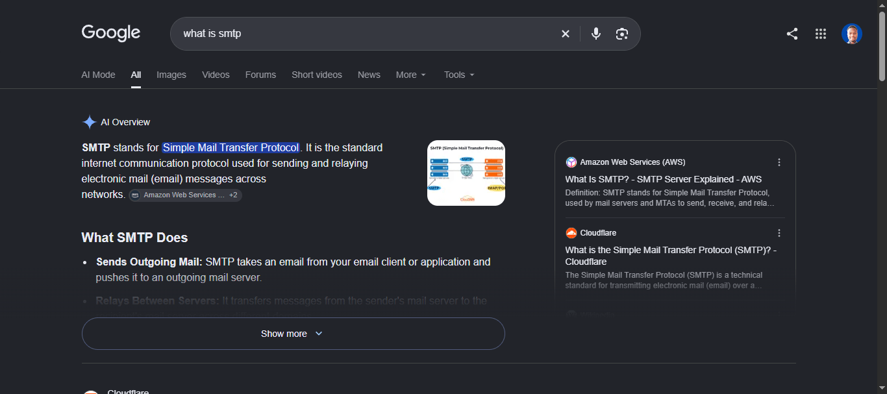
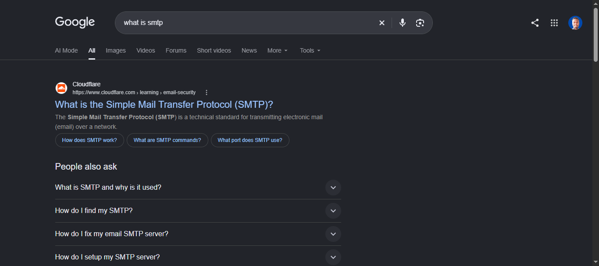

# Hide AI Overview

A lightweight browser extension for Chrome, Edge, Brave, and other
Chromium-based browsers that hides Google's **AI Overview** section from
search results.

Ads and regular search results remain visible. Use the toolbar button to
switch the extension on or off. Your choice is saved and restored when
the browser restarts.

## Features

-   Hides Google's AI Overview using stable page selectors.
-   Keeps top ads, organic results, and other search features visible.
-   Adds an **ON/OFF** badge to the toolbar icon.
-   Applies toggle changes to open Google Search tabs without requiring
    a reload.
-   Handles single-page navigation and AI Overview content added after
    the page loads.
-   Supports 15 regional Google domains.
-   Runs locally: no analytics, telemetry, remote code, or external
    network requests.

## Screenshots

| Before | After |
|--------|-------|
|  |  |

## Installation

### Chrome, Edge, Brave, and Opera

1.  Open your browser's extensions page:
    -   Chrome: `chrome://extensions/`
    -   Edge: `edge://extensions/`
    -   Brave: `brave://extensions/`
2.  Turn on **Developer mode**.
3.  Select **Load unpacked**.
4.  Choose the `hide-ai-overview/` folder containing `manifest.json`.
5.  Pin the extension if you want quick access to its toolbar button.

The extension starts enabled by default. Its toolbar badge should show
**ON**.

### Firefox (temporary installation)

1.  Open `about:debugging#/runtime/this-firefox`.
2.  Select **Load Temporary Add-on...**.
3.  Choose the `manifest.json` file inside the `hide-ai-overview/`
    folder.

A temporary add-on remains installed only for the current Firefox
session. For a permanent Firefox release, the extension must be
submitted to Mozilla Add-ons for signing.

## Usage

-   **Default:** ON --- AI Overview is hidden.
-   Click the toolbar icon to switch between ON and OFF.
-   **ON** (red badge): the AI Overview is hidden.
-   **OFF** (gray badge): the AI Overview is visible.
-   The setting is saved locally and persists across browser restarts.
-   Open Google Search tabs update when you toggle the extension. New
    tabs use the saved setting.

## Project structure

``` text
hide-ai-overview/
├── manifest.json       # Extension manifest (Manifest V3)
├── background.js       # Service worker: state, injection, and badge
├── hide.js             # Content script: identifies and hides AI Overview
├── hide.css            # CSS fallback for immediate hiding
├── README.md           # Project documentation
└── icons/
    ├── icon16.png      # Toolbar icon
    ├── icon48.png      # Extensions page icon
    └── icon128.png     # Store and large icon
```

## How it works

### Selectors

The extension targets these page elements:

  Selector                 Purpose
  ------------------------ ------------------------------
  `#Odp5De`                Primary AI Overview wrapper
  `#eKIzJc`                AI Overview card container
  `div[jsname="ZLxsqf"]`   AI Overview component marker
  `div[jsname="dEwkXc"]`   AI Overview controller

It avoids request-specific or frequently changing identifiers such as
`ZzEQrc_*`, `PX9obf_*`, `_HNnpat_*`, `_9drpav*`, `fld_*`, and `tsuid_*`.

The extension also deliberately avoids broad containers that could hide
unrelated search content:

-   `.bzXtMb` --- can contain both the top ad block and AI Overview.
-   `#tads`, `#tvcap`, and `#oFNiHe` --- ad containers.
-   Organic results, knowledge panels, and "People also ask" sections.

### Toggle behavior

1.  Clicking the toolbar icon switches the `enabled` value in
    `chrome.storage.local`.
2.  When enabled, `background.js` injects `hide.css` and `hide.js`.
3.  When disabled, it removes the injected CSS and sends a
    `{type: "setState", enabled: false}` message so the content script
    can restore the page.
4.  `hide.js` listens for state changes and updates the current tab.
5.  The background service worker handles Google tab updates and applies
    the saved state where needed.

## Permissions

  -----------------------------------------------------------------------
  Permission                          Why it is needed
  ----------------------------------- -----------------------------------
  `storage`                           Saves the ON/OFF setting across
                                      browser restarts.

  `scripting`                         Injects or removes the CSS and
                                      JavaScript used to control
                                      visibility.

  `host_permissions`                  Limits extension access to the
                                      supported Google Search domains.
  -----------------------------------------------------------------------

The extension does not request `<all_urls>` access. It does not collect
analytics or send data to external servers.

## Adding another Google domain

The extension currently supports 15 regional Google domains. To add
another domain:

1.  Add the matching pattern, such as `*://www.google.XX/*`, to
    `host_permissions` in `manifest.json`.
2.  Add the same pattern to `GOOGLE_URL_PATTERNS` in `background.js`.

Keep both lists in sync. A domain missing from either list may not
receive the extension's scripts.

## Troubleshooting

### AI Overview is still visible

1.  Check that the toolbar badge shows **ON**.

2.  Reload the Google Search tab once.

3.  Open the tab's DevTools console and run:

    ``` js
    window.__hideAiOverviewInstalled
    ```

    The expected result is `true`.

4.  Google may have changed its page structure. Inspect the AI Overview
    element and update the stable selectors in `hide.js` and `hide.css`
    if necessary.

### The toolbar toggle does nothing

-   Open the browser's extensions page.
-   Check the extension's **Errors** section or service worker console.
-   If you recently edited `manifest.json`, reload the extension from
    the extensions page.

### The badge changes, but an existing tab does not

Reload that Google Search tab once. Tabs that were already open before
the extension was installed may need an initial reload.

### The extension icon does not load

-   Confirm the icon files exist inside the `icons/` directory.
-   Check that `manifest.json` points to paths such as
    `icons/icon16.png`, not `icon16.png`.

### Firefox injection issues

Open `about:debugging`, select **Inspect** for the extension, and check
the extension console for errors. Firefox's Manifest V3 support and
scripting behavior may differ from Chromium browsers.

## Uninstall

1.  Open your browser's extensions page.
2.  Find **Hide AI Overview**.
3.  Select **Remove** and confirm.

The browser removes the extension's locally stored settings when the
extension is uninstalled.

## Disclaimer

Hide AI Overview is an unofficial, third-party browser extension. It is
not affiliated with, endorsed by, or sponsored by Google LLC. Google and
AI Overview are trademarks of Google LLC and are used only to describe
the functionality of this project.

Google may change the structure of its Search pages at any time. If its
page selectors change, the extension may need an update to keep working.

The extension changes only how selected elements appear in your browser.
It does not modify Google's servers, network traffic, or account data.

## License

Released under the [MIT License](LICENSE).
